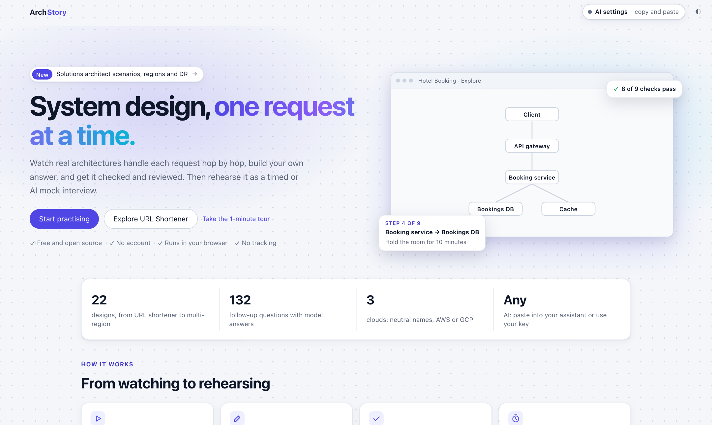
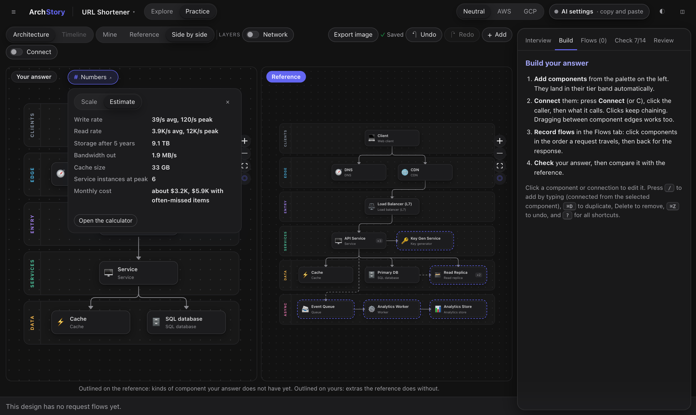
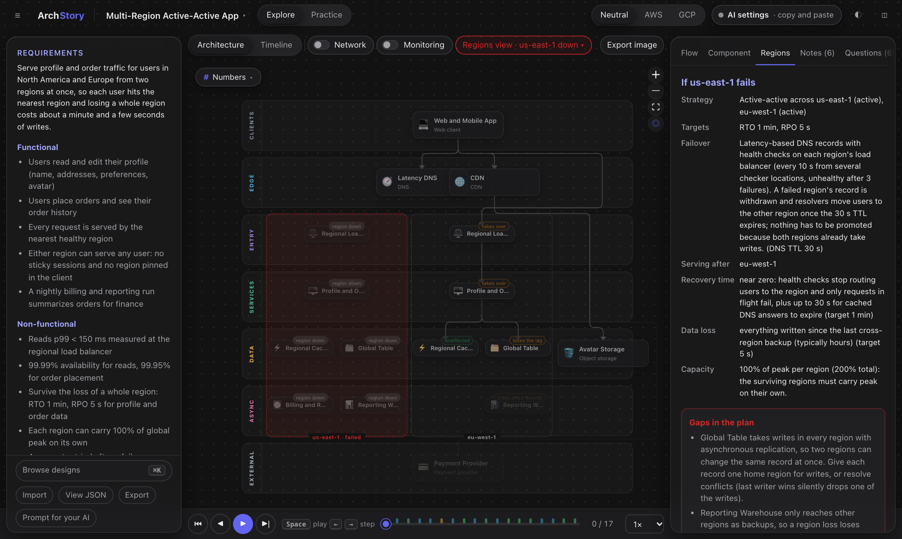

<div align="center">


# ArchStory

### System design, one request at a time.

Watch real architectures handle each request hop by hop, build your own answer,<br />
get it checked and reviewed, then rehearse it as a timed or AI mock interview.

<p>
  <a href="https://vishbay.github.io/archstory/"></a>
</p>
<p>
  <a href="https://github.com/vishbay/archstory/releases"></a>
  <a href="LICENSE"></a>
  
  
  
  
</p>

**Free and open source** · **No account** · **Runs in your browser** · **No tracking**

<br />


</div>

<br />

## Why ArchStory

System design interviews are not about memorising boxes and arrows. They are about explaining **what happens to a request**, **what breaks first**, and **what you would trade off**. ArchStory makes that concrete:

- 🎬 **See it move.** Every design comes with request flows you play step by step, with the real message (HTTP, SQL, events) and why each hop happens.
- ✏️ **Build your own.** Draw your answer on the same canvas, record its flows, and get automatic checks against a reference.
- 🎙️ **Rehearse it.** Timed interviews with a checklist per phase, an AI interviewer you can answer out loud, and follow-up questions that come back until you know them.

<table>
  <tr>
    <td width="50%"><br /><sub><b>Home</b>: start from the library or bring your own question</sub></td>
    <td width="50%"><br /><sub><b>Practice</b>: your answer next to the reference, gaps outlined, numbers to hand</sub></td>
  </tr>
  <tr>
    <td colspan="2"><br /><sub><b>Fail a region</b>: what keeps serving, what data is lost, how long recovery takes, and the gaps in the plan</sub></td>
  </tr>
</table>

## The library

22 designs, each with requirements, 2 to 4 request flows, notes on trade-offs and failure, monitoring, starting numbers for estimates, and 6 follow-up questions with model answers. 🟢 easy · 🟡 medium · 🔴 hard

| Classic interview questions | | Solutions architect scenarios | |
|---|---|---|---|
| 🟢 URL Shortener | 🟡 Search Autocomplete | 🔴 Multi-Region Active-Active App | 🔴 Monolith to Cloud Migration |
| 🟡 News Feed | 🟡 Distributed Rate Limiter | 🟡 RAG Knowledge Assistant | 🟡 Data Platform: Lake and Warehouse |
| 🟡 Video Streaming | 🟡 Notification System | 🟡 IoT Telemetry Platform | 🟡 Enterprise Integration Backbone |
| 🟡 Multi-tenant SaaS | 🟡 Distributed Job Scheduler | | |
| 🔴 Chat Messaging | 🔴 Ride Hailing | | |
| 🔴 E-commerce Checkout | 🔴 Ticket Booking | | |
| 🔴 File Storage and Sync | 🔴 Web Crawler | | |
| 🔴 Distributed Key-Value Store | 🔴 Payment Ledger | | |

**Not limited to these.** Import any other question as JSON, or press *Prompt for your AI* and have ChatGPT, Claude, Gemini or any assistant write one. An imported design gets everything the built-in ones do.

## Features

<table>
<tr><td valign="top" width="50%">

**Explore**
- Request flows, step by step, with the camera following each hop
- Cloud-neutral names, or AWS and GCP with official icons
- Network layer: VPCs, subnets, availability-zone failure drills
- Regions and disaster recovery: RTO, RPO, replication, region failure drill
- Hybrid designs with an on-premises box and a hybrid link
- Monitoring: SLOs, error budgets, alerts, what to watch and how to debug
- Export the canvas as a PNG

</td><td valign="top" width="50%">

**Practice**
- Draw your answer: palette, `/` quick add, skeletons to start from
- Record flows and run automatic checks against the reference
- Three hints before the full answer, side by side to compare
- Written reasoning, including security and key decisions
- Timed interviews (30, 45 or 60 minutes) with a checklist per phase
- AI interviewer by text or voice, and AI review with scores on your design
- Saved attempts with progress over time, backup and restore

</td></tr>
<tr><td valign="top">

**Numbers**
- Each design opens with its own starting estimates
- Requests per second, storage, bandwidth, cache and instances, arithmetic shown
- A rough monthly bill, the usual ways to cut it, named for your cloud
- *Often missed* costs: cross-zone and cross-region traffic, load balancers, NAT gateways, logs

</td><td valign="top">

**Drill**
- 132 follow-up questions interviewers ask next, with model answers
- A daily spaced-repetition drill: the ones you miss come back sooner
- Imported designs' questions join the drill too

</td></tr>
</table>

## Quick start

Use it in the browser: **[vishbay.github.io/archstory](https://vishbay.github.io/archstory/)**. Or run it yourself:

```bash
git clone https://github.com/vishbay/archstory.git
cd archstory
npm install
npm run dev     # http://localhost:5173
npm test
```

## AI, your way

ArchStory has no AI of its own and no server. For reviews, making designs and the AI interviewer, pick one:

- **Copy and paste** (the default): ArchStory writes the prompt, you paste it into ChatGPT, Claude, Gemini or any assistant and paste the reply back. Nothing beyond the subscription you already have.
- **Your own API key** (optional): Anthropic, OpenAI, Google Gemini, DeepSeek, or a local OpenAI-compatible server such as Ollama or LM Studio. ArchStory sends the prompt for you and you pay the provider per token, usually a few dollars a month. You can set a model per feature, for example a strong one for reviews and a cheap, fast one for the interviewer.

Your key stays in your browser (for the tab only, unless you choose to remember it) and goes only to the provider you pick.

<details>
<summary><b>What the AI features cost, per provider and model</b></summary>

<br />

Estimated cost per action and per month, in US dollars, at list prices on 10 November 2026:

| Provider | Model | Review | Make a design | AI interview (20 questions) | Light month | Regular month | Intensive month |
|---|---|---|---|---|---|---|---|
| Anthropic | Claude Haiku 5.5 | $0.002 | $0.006 | $0.004 | $0.04 | $0.09 | $0.30 |
| Anthropic | Claude Sonnet 5.5 | $0.04 | $0.11 | $0.07 | $0.68 | $1.79 | $5.52 |
| Anthropic | Claude Opus 5.5 | $0.08 | $0.23 | $0.13 | $1.36 | $3.57 | $11.04 |
| OpenAI | GPT-6 Luna | $0.002 | $0.006 | $0.02 | $0.06 | $0.19 | $0.66 |
| OpenAI | GPT-6.1 Terra | $0.02 | $0.06 | $0.16 | $0.60 | $1.92 | $6.61 |
| OpenAI | GPT-6.1 Sol | $0.04 | $0.11 | $0.32 | $1.20 | $3.84 | $13.22 |
| OpenAI | GPT-6 Astra | $0.20 | $0.57 | $1.61 | $5.98 | $19.19 | $66.09 |
| Google | Gemini 3.1 Flash-Lite | $0.006 | $0.02 | $0.04 | $0.16 | $0.51 | $1.73 |
| Google | Gemini 3.8 Flash | $0.02 | $0.04 | $0.12 | $0.45 | $1.44 | $4.96 |
| Google | Gemini 4 Argon | $0.04 | $0.11 | $0.32 | $1.20 | $3.84 | $13.22 |
| DeepSeek | DeepSeek Flash | $0.005 | $0.01 | $0.05 | $0.16 | $0.54 | $1.89 |
| DeepSeek | DeepSeek V4 Pro | $0.02 | $0.05 | $0.21 | $0.67 | $2.24 | $7.88 |
| Local | Ollama or LM Studio | free | free | free | free | free | free |

How these are worked out:

- **Measured prompt sizes**: a review sends about 5,700 tokens and gets about 2,000 back; making a design sends about 6,700 and gets 6,000 to 9,000 back. One reply in four is assumed to need the automatic fix request, which roughly doubles that call.
- **AI interview**: 22 calls (opening, 20 answers, feedback). Every reply re-sends the conversation, about 150,000 input tokens in total. ArchStory turns on Anthropic's prompt caching, which charges most of that at the cached rate; the OpenAI, Gemini and DeepSeek figures assume no caching, so treat them as an upper limit (all three cache repeated prompts automatically).
- **Months**: light is 8 reviews, 2 designs and 2 interviews; regular is 20, 4 and 8; intensive (the month before an interview) is 60, 10 and 30.
- **Price changes**: Google has announced that Gemini 4 Argon doubles from 1 December 2026 and Gemini 3.8 Flash from 1 January 2027. Check current prices: [Anthropic](https://platform.claude.com/docs/en/about-claude/pricing), [OpenAI](https://openai.com/api/pricing/), [Google](https://ai.google.dev/gemini-api/docs/pricing), [DeepSeek](https://api-docs.deepseek.com/quick_start/pricing). DeepSeek charges half price outside its peak hours (01:00 to 04:00 and 06:00 to 10:00 UTC on weekdays); the table uses the peak price. Add your own prices in the AI settings to see a running cost during an AI interview.
- **Voice**: speaking your answers and hearing questions read aloud use your browser's built-in speech features, so they add no cost. Chrome sends speech to Google to turn it into text. A dedicated speech service would add roughly $0.005 a minute of speech (Gemini 3.5 Transcribe Live), about $0.10 to $0.15 for a 45-minute interview.

For interview practice, a mid-range model (Claude Sonnet 5.5, GPT-6.1 Sol or Gemini 3.8 Flash) gives good reviews and probing questions for a few dollars a month. The smallest models are close to free and fine for quick drills; the largest ones rarely improve a design review enough to justify the cost. You can also set a model per feature in the AI settings, for example a strong model for reviews and making designs and a faster, cheaper one for the AI interviewer.

</details>

## Privacy

- No analytics, no trackers, no account, no ArchStory server.
- Your answers, attempts, reviews and settings live in your browser's local storage. *Back up* in Practice exports them as a JSON file, which is also how you move them to another device.
- The only requests that leave your browser are the ones you start: AI calls to the provider you connect, and loading the author card from GitHub.

## Add a design

**In the app** (nothing to install): use *Import* in the left panel or on the home page, or *Prompt for your AI*. Imported designs are saved in your browser under *My designs* and work exactly like the library.

**In the repo**, to contribute one to the library: designs are JSON files in the [`archstory/v1`](public/schema/archstory-v1.json) format, with components, connections, request flows and optional monitoring, regions and estimate numbers. Layout is automatic. Add a file to `src/library/` and run `npm test` to validate it.

<details>
<summary><b>Format notes: multi-region, hybrid and on-premises designs</b></summary>

<br />

#### Multi-region designs

Add a top-level `regions` section only when the question is about more than one region (disaster recovery, global users). It lists the regions and how the design survives losing one:

- `regions`: two or more `{ id, name, role }`. `role` is `primary` or `secondary` for `backup-restore`, `pilot-light` and `warm-standby`; every region is `active` for `active-active`.
- `strategy`: `backup-restore` (hours to recover), `pilot-light` (tens of minutes), `warm-standby` (minutes) or `active-active` (near zero).
- `rto` and `rpo`: the targets as text, for example `"15 min"` and `"1 min"`.
- `failover`: how traffic moves, for example `"DNS failover on health checks"`. `dnsTtl` (seconds, optional) is checked against the RTO.

Two optional fields on components say where they run. `regions` is `all` (a copy in every region, run as the strategy says), `primary` (only in the primary region) or `global` (DNS, CDN, a global load balancer or a globally replicated store); edge components (DNS, CDN, WAF) default to `global`, everything else to `all`, and clients and third parties always sit outside the regions. `replication` on a data store is `sync` (nothing lost, every write waits for a cross-region round trip), `async` (loses the replication lag), `backup` (loses everything since the last backup) or `none`; it defaults to `backup` for backup and restore, `none` for caches and `async` otherwise.

```json
"regions": {
  "regions": [
    { "id": "use1", "name": "us-east-1", "role": "primary" },
    { "id": "usw2", "name": "us-west-2", "role": "secondary" }
  ],
  "strategy": "warm-standby", "rto": "15 min", "rpo": "1 min",
  "failover": "DNS failover on health checks", "dnsTtl": 60
},
"nodes": [
  { "id": "db", "label": "Orders DB", "kind": "sql_db", "replication": "async" },
  { "id": "fraud", "label": "Fraud Check", "kind": "service", "regions": "primary" }
]
```

#### Hybrid and on-premises designs

For migration or hybrid questions, give a component that runs in the customer's own data centre `"site": "onprem"` (the default is `cloud`). It is drawn in an On-premises box outside the VPC, the zones and the regions, and failing a cloud zone or region does not touch it; the Resilience panel still warns that the data centre is a single site. An on-prem component takes no cloud `subnet`, `regions` or `replication`. Connect it to the cloud through a `hybrid_link` node (Direct Connect, Cloud Interconnect or a site-to-site VPN), and hops across it are described with their latency and per-GB cost.

```json
{ "id": "link", "label": "Hybrid Link", "kind": "hybrid_link", "cloud": { "aws": "Direct Connect", "gcp": "Cloud Interconnect" } },
{ "id": "erp", "label": "ERP", "kind": "service", "site": "onprem" }
```

Other kinds for these questions: `mqtt_broker` (IoT devices), `vector_db` (embeddings for retrieval), `llm` (a model endpoint such as Amazon Bedrock or Vertex AI), `schema_registry` and `data_catalog`. Any other kind still works and draws as a generic component.

</details>

## License

[MIT](LICENSE). AWS and Google Cloud icons are downloaded from the providers on first run and are not part of this repository; see [THIRD_PARTY_NOTICES.md](THIRD_PARTY_NOTICES.md). ArchStory is not affiliated with Amazon or Google.

<div align="center"><sub>Made by <a href="https://github.com/vishbay">@vishbay</a>. Psst: click the logo in the app five times.</sub></div>
