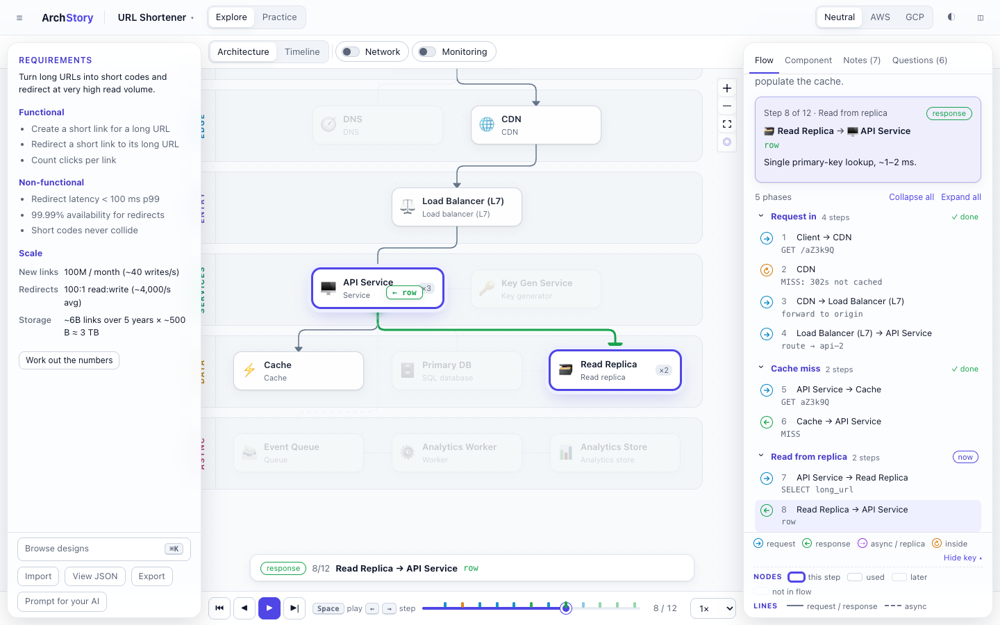

# ArchStory

**System design, one request at a time.**

Explore real architectures and watch each request travel through them hop by hop. Then build your own answer, check it against a reference, and get it reviewed.

**[Try the live demo →](https://vishbay.github.io/archstory/)**



## Features

- **Explore** 12 designs with step-by-step request flows: URL shortener, news feed, ride hailing, chat, video streaming, checkout, ticket booking, file storage and sync, multi-tenant SaaS, autocomplete, rate limiter and notifications.
- **Any cloud**: switch between cloud-neutral names, AWS and GCP, with official icons.
- **Network and zones**: VPCs, subnets and availability-zone failure drills.
- **Monitoring**: SLOs with error budgets, alerts (page or ticket), what to watch on each component and how to debug it, plus a telemetry layer you can switch on.
- **Practice**: draw your own design (type `/` to add components, start from a skeleton), record its flows and get automatic checks against a reference. Save attempts and track your progress.
- **Timed interviews**: the usual phases on a 30, 45 or 60 minute clock, with a checklist for each.
- **Estimate calculator**: requests per second, storage, bandwidth and cache size, with the arithmetic shown.
- **Follow-up questions**: 72 questions interviewers ask next, with model answers and a daily spaced-repetition drill.
- **AI interviewer** (optional, your own API key): a mock interview that asks one question at a time about your design, by text or voice.
- **Review with your own AI**: ArchStory writes the prompt and its findings appear on your design. Paste it into any assistant, or optionally connect your own API key (Anthropic, OpenAI, Gemini, or a local server such as Ollama) to send it from the app.
- **Bring your own**: import JSON and build designs with your own AI. No AI or server of its own, no account. An API key stays in your browser and goes only to the provider you pick.

## Quick start

```bash
npm install
npm run dev     # http://localhost:5173
npm test
```

## What AI costs

Everything except the AI features is free and runs in your browser. For the AI features you have two options:

- **Copy and paste** (the default): ArchStory writes the prompt and you paste it into ChatGPT, Claude, Gemini or any assistant. It costs nothing beyond the subscription you already have.
- **Your own API key** (optional): ArchStory sends the prompt for you and you pay the provider per token. A local model through Ollama or LM Studio costs nothing.

Estimated cost per action and per month, in US dollars, at list prices on 10 November 2026:

| Provider | Model | Review | Make a design | AI interview (20 questions) | Light month | Regular month | Intensive month |
|---|---|---|---|---|---|---|---|
| Anthropic | Claude Haiku 5.5 | $0.002 | $0.006 | $0.004 | $0.04 | $0.09 | $0.30 |
| Anthropic | Claude Sonnet 5.5 | $0.04 | $0.11 | $0.07 | $0.68 | $1.79 | $5.52 |
| Anthropic | Claude Opus 5.5 | $0.08 | $0.23 | $0.13 | $1.36 | $3.57 | $11.04 |
| OpenAI | GPT-6 Luna | $0.002 | $0.006 | $0.02 | $0.06 | $0.19 | $0.66 |
| OpenAI | GPT-6.1 Terra | $0.02 | $0.06 | $0.16 | $0.60 | $1.92 | $6.61 |
| OpenAI | GPT-6.1 Sol | $0.04 | $0.11 | $0.32 | $1.20 | $3.84 | $13.22 |
| OpenAI | GPT-6 Astra | $0.20 | $0.57 | $1.61 | $5.98 | $19.19 | $66.09 |
| Google | Gemini 3.1 Flash-Lite | $0.006 | $0.02 | $0.04 | $0.16 | $0.51 | $1.73 |
| Google | Gemini 3.8 Flash | $0.02 | $0.04 | $0.12 | $0.45 | $1.44 | $4.96 |
| Google | Gemini 4 Argon | $0.04 | $0.11 | $0.32 | $1.20 | $3.84 | $13.22 |
| Local | Ollama or LM Studio | free | free | free | free | free | free |

How these are worked out:

- **Measured prompt sizes**: a review sends about 5,700 tokens and gets about 2,000 back; making a design sends about 6,700 and gets 6,000 to 9,000 back. One reply in four is assumed to need the automatic fix request, which roughly doubles that call.
- **AI interview**: 22 calls (opening, 20 answers, feedback). Every reply re-sends the conversation, about 150,000 input tokens in total. ArchStory turns on Anthropic's prompt caching, which charges most of that at the cached rate; the OpenAI and Gemini figures assume no caching, so treat them as an upper limit (both providers cache repeated prompts automatically).
- **Months**: light is 8 reviews, 2 designs and 2 interviews; regular is 20, 4 and 8; intensive (the month before an interview) is 60, 10 and 30.
- **Price changes**: Google has announced that Gemini 4 Argon doubles from 1 December 2026 and Gemini 3.8 Flash from 1 January 2027. Check current prices: [Anthropic](https://platform.claude.com/docs/en/about-claude/pricing), [OpenAI](https://openai.com/api/pricing/), [Google](https://ai.google.dev/gemini-api/docs/pricing). Add your own prices in the AI settings to see a running cost during an AI interview.
- **Voice**: speaking your answers and hearing questions read aloud use your browser's built-in speech features, so they add no cost. Chrome sends speech to Google to turn it into text. A dedicated speech service would add roughly $0.005 a minute of speech (Gemini 3.5 Transcribe Live), about $0.10 to $0.15 for a 45-minute interview.

For interview practice, a mid-range model (Claude Sonnet 5.5, GPT-6.1 Sol or Gemini 3.8 Flash) gives good reviews and probing questions for a few dollars a month. The smallest models are close to free and fine for quick drills; the largest ones rarely improve a design review enough to justify the cost. You can also set a model per feature in the AI settings, for example a strong model for reviews and making designs and a faster, cheaper one for the AI interviewer.

## Add a design

Designs are JSON files in the [`archstory/v1`](public/schema/archstory-v1.json) format: components, connections and request flows. Layout is automatic. Add a file to `src/library/` and run `npm test` to validate it.

## License

[MIT](LICENSE). AWS and Google Cloud icons are downloaded from the providers on first run and are not part of this repository; see [THIRD_PARTY_NOTICES.md](THIRD_PARTY_NOTICES.md). ArchStory is not affiliated with Amazon or Google.
